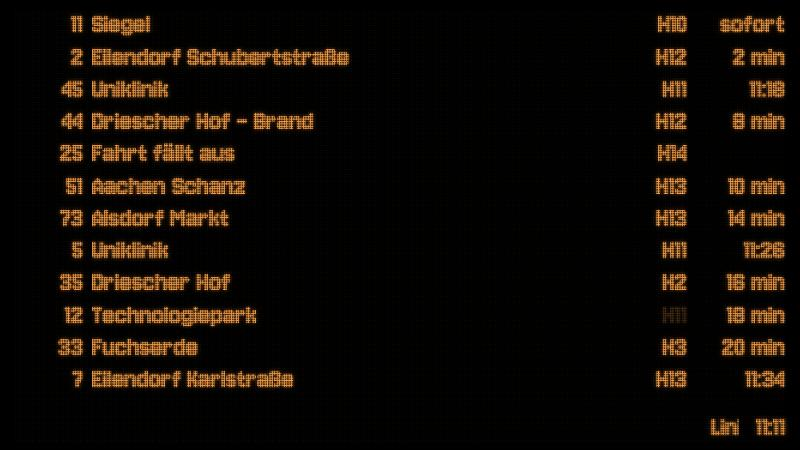
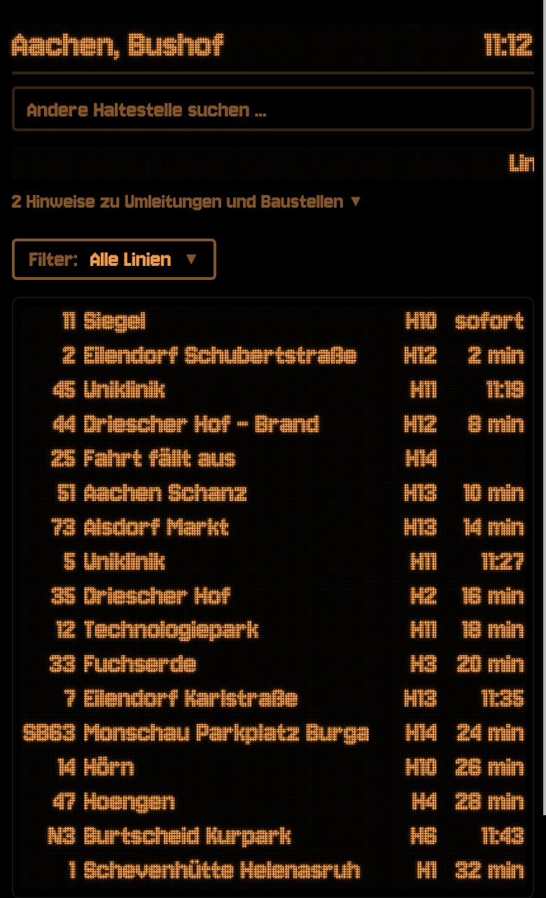

# AVV Departures

Live departure board for Aachen and the whole AVV area, styled like the amber LED displays at the bus stops.

**[bushof-monitor.vercel.app](https://bushof-monitor.vercel.app)** · no dependencies · no build step

<p align="center">
  
  &nbsp;
  
</p>

## Features

- **Every stop in the AVV area**: Aachen, Städteregion, Düren, Heinsberg and the border region. It starts at Aachen Bushof; the search switches to any other stop and remembers recent ones.
- **Real-time data**: minutes until departure, clock times where no live data exists, cancellations shown as "Fahrt fällt aus", platforms and tracks.
- **Disruption notices** as a scrolling LED line, with the full list one tap away.
- **Line filter**, remembered per stop.
- **Display mode** for a TV or wall screen: full screen, keeps the screen awake, filterable by platform and line.
- **Works offline** for the app shell and keeps showing the last data (marked as stale) if the data source is down.

## Display mode

Open `/anzeige` and click to toggle full screen. URL parameters can be combined:

| URL | Shows |
| --- | --- |
| `/anzeige` | all departures at Aachen Bushof |
| `/anzeige?station=1029` | another stop (the id is in the main view's URL) |
| `/anzeige?steig=10,11` | only platforms H.10 and H.11 |
| `/anzeige?linien=33,47` | only lines 33 and 47 |

## Run it locally

Requires Node.js 20 or newer.

```bash
npm start      # http://localhost:3000
npm run demo   # fake data with delays, cancellations and notices
npm test       # parser tests against recorded responses
```

Deploys to Vercel as is: `public/` is served statically, `api/` becomes serverless functions.

## How it works

The server talks to the AVV's public HAFAS endpoint (`auskunft.avv.de/bin/mgate.exe`), the same one the official AVV app uses, and turns its responses into a small JSON API:

- `GET /api/departures?station=<id>` returns the next departures and disruption notices. Results are cached for 15 seconds per stop; if HAFAS is unreachable, the last good response comes back with `stale: true`.
- `GET /api/stations?q=<query>` searches stops within the AVV area.

The frontend is plain HTML, CSS and JavaScript. It polls every 30 seconds, pauses in background tabs and renders the LED look with CSS only, using the [Jersey 10](https://fonts.google.com/specimen/Jersey+10) font (self-hosted, SIL OFL).

```
public/   main view, display mode, LED styles, service worker
lib/      HAFAS client and parsing, caching, demo data
api/      Vercel functions
test/     node:test suite with recorded HAFAS responses
```

GitHub Actions run the tests on every pull request and check the live site every morning.

## Disclaimer

This is a private project and not affiliated with the AVV, ASEAG or any other transport company. It uses an unofficial interface that may change at any time. Departure data © the respective transport companies.

## License

[MIT](LICENSE)
